# VOID_Awards

Картинки и описания наград (медалей) для личного кабинета плагина VOID_System, сервер Unturned «VOID: Молот войны».

Репозиторий **публичный**: игра скачивает картинки по прямой ссылке, без входа в GitHub. Здесь только PNG, описания и SQL-запрос без паролей — ничего секретного.

## Как устроено

- Каждая медаль — PNG **256×256**, прозрачный фон: пиксель-арт 32×32, увеличенный в 8 раз без сглаживания.
- Файлы лежат в папке `awards/`, имена — `medal_НОМЕР.png` (`medal_01.png` … `medal_24.png`).
- Ссылка на файл: `https://raw.githubusercontent.com/Hunter-KMV/VOID_Awards/main/awards/medal_01.png`.
- Названия, описания и старшинство — в `awards.json`. Плагин берёт их **из базы** (таблица `Award_Table`), поэтому после изменения их нужно один раз внести в базу запросом из папки `sql/`.
- В базе (`Award_Table.Award_Image`) пишется только имя файла. Начало ссылки задаётся в `config.yaml` плагина: `awards.imageBaseUrl`.
- `award_000.png` — заглушка «нет картинки».
- `award_001.png` … `award_010.png` — старые временные медали. Их не удаляем: на чистой базе плагин пока пишет их сам (до следующей версии VOID_System).

## Как поставить набор в игру

1. Отправить репозиторий на GitHub (`git push`) — картинки станут доступны по ссылкам.
2. В базе `void_system` один раз выполнить `sql/medals_v3.sql`. Перед этим посмотреть каталог запросом из начала файла.
3. Перезапуск сервера не нужен. Игроки, у которых игра уже запомнила старые картинки, увидят новые после перезахода.

## Новая медаль

1. Нарисовать 32×32 (Piskel, Aseprite) и экспортировать с увеличением ×8 → 256×256.
2. Положить в `awards/` под новым именем, например `medal_25.png`, и дописать её в `awards.json`.
3. Закоммитить и отправить: `git add -A`, `git commit -m "Медаль 25"`, `git push`.
4. Добавить строку в `Award_Table` (название, описание, `medal_25.png`, старшинство).

> Игра запоминает картинку по ссылке до перезапуска. Перерисовал медаль — сохрани её под **новым** именем (`medal_07_v2.png`) и поменяй имя в базе.

## Сейчас здесь — набор v3 (8 ноября 2026)

24 медали в мрачном торжественном стиле: черепа, орлы, красный, чёрный и золотой. Порядок — по старшинству (`Award_Order`: меньше — выше в списке у игрока).

| | № | Название | Описание | Старшинство | Файл |
|---|---|---|---|---|---|
| 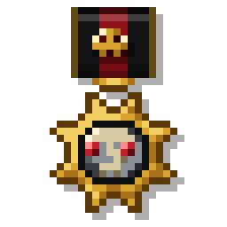 | 1 | **Звезда Молота** | Высшая награда VOID. Вручается тому, чья воля стала молотом, а имя — приговором для врагов. Носящий её не отступает и не просит пощады. | 10 | `medal_01.png` |
| 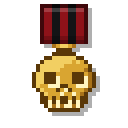 | 2 | **Золотой Череп** | Знак тех, кто смотрел смерти в лицо и заставил её отвести взгляд. Золото не тускнеет — как и память о сделанном. | 20 | `medal_02.png` |
| 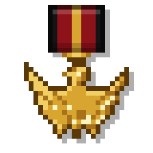 | 3 | **Орден Полководца** | Командиру, который вёл людей сквозь огонь и привёл их назад. Золотой орёл раскрывает крылья над теми, кто умеет побеждать. | 30 | `medal_03.png` |
| 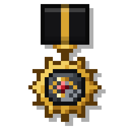 | 4 | **Око Ставки** | Око, что не смыкается. Вручается тем, кто видел врага раньше, чем враг видел их, и чьи сведения решили исход боя. | 40 | `medal_04.png` |
| 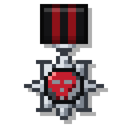 | 5 | **Орден Неравного боя** | За бой, в котором врагов было больше. Алый череп на стальной звезде — напоминание, что число ещё не победа. | 50 | `medal_05.png` |
| 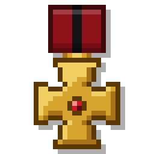 | 6 | **Крест Крови** | За пролитую кровь — свою и вражескую. Рубин в сердце креста не стирается и не продаётся. | 60 | `medal_06.png` |
| 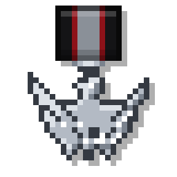 | 7 | **Стальной Орёл** | Серебряный орёл для тех, кто годами стоит на передовой. За долгую и безупречную службу, когда о славе уже никто не думает. | 70 | `medal_07.png` |
| 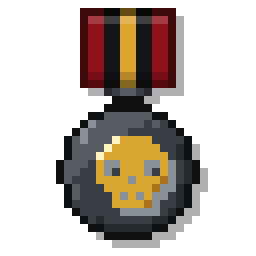 | 8 | **Печать Тишины** | Ставится на тех, после чьего прихода наступает тишина. За точную, тихую и беспощадную работу. | 80 | `medal_08.png` |
| 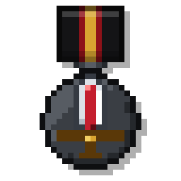 | 9 | **Клинок Штурма** | Первому, кто ворвался во вражеские стены. Клинок с кровавым долом — знак тех, кто открывает дорогу остальным. | 90 | `medal_09.png` |
| 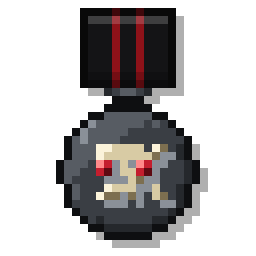 | 10 | **Знак Обречённых** | Тем, кто пошёл туда, откуда не возвращаются, — и вернулся. Череп и кости не пугают тех, кто их носит. | 100 | `medal_10.png` |
| 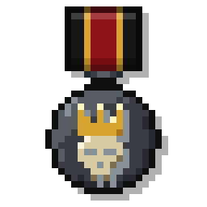 | 11 | **Корона Павших** | В память о тех, кто пал, удерживая своё. Корона венчает череп — ибо павшие правят памятью живых. | 110 | `medal_11.png` |
| 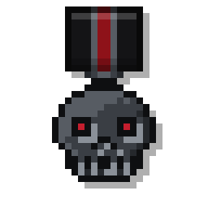 | 12 | **Железный Череп** | Железо проще золота, но не слабее. Вручается бойцам, чья стойкость выдержала то, что ломает других. | 120 | `medal_12.png` |
| 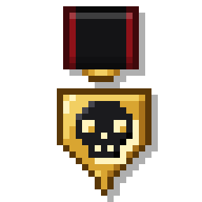 | 13 | **Чёрный Щит** | Тому, кто стал щитом для товарищей. Чёрный череп на золоте — предупреждение каждому, кто решит напасть. | 130 | `medal_13.png` |
| 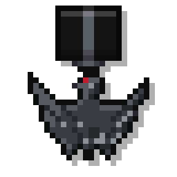 | 14 | **Чёрное Крыло** | Знак тех, кто приходит из темноты. Чёрный орёл с алым глазом — за вылазки, о которых не пишут в отчётах. | 140 | `medal_14.png` |
| 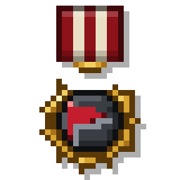 | 15 | **Знамя отличия** | Бойцу, чьё знамя не упало. Красный стяг в золотом венке — за честь, удержанную до конца. | 150 | `medal_15.png` |
| 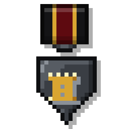 | 16 | **За оборону рубежа** | Тем, кто держал рубеж, когда отступить было проще. Башня стоит, пока стоят её защитники. | 160 | `medal_16.png` |
| 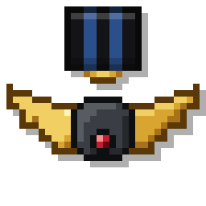 | 17 | **Крылья Неба** | Пилотам и всем, кто держит небо над VOID. Золотые крылья — за полёты сквозь огонь. | 170 | `medal_17.png` |
| 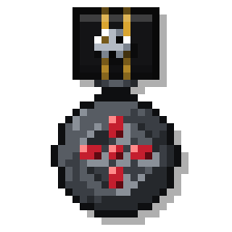 | 18 | **Чёрный Прицел** | Стрелку, чей выстрел решает всё. Один вдох, один выстрел, одна цель. | 180 | `medal_18.png` |
| 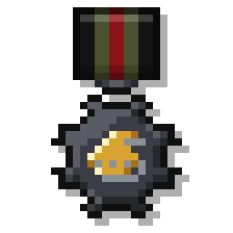 | 19 | **Знак экипажа** | Экипажу боевой машины. Броня, мотор и люди внутри — одно целое, пока бой не окончен. | 190 | `medal_19.png` |
| 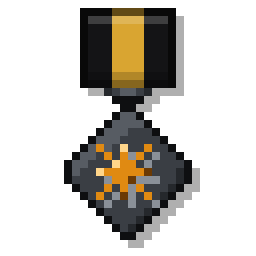 | 20 | **Знак сапёра** | Сапёру, который ошибается лишь однажды — и ещё ни разу не ошибся. За мины, заряды и проходы сквозь смерть. | 200 | `medal_20.png` |
| 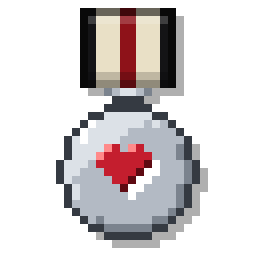 | 21 | **Знак полевого медика** | Тому, кто вытаскивал раненых из-под огня. Красное сердце на серебре — за каждую спасённую жизнь. | 210 | `medal_21.png` |
| 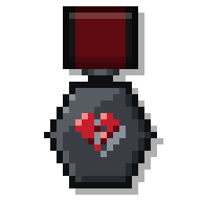 | 22 | **Знак стойкости** | Треснувшее сердце, которое продолжает биться. За то, чтобы подняться после поражения и снова идти в бой. | 220 | `medal_22.png` |
| 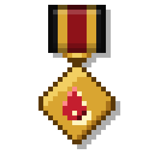 | 23 | **За верность присяге** | Тем, кто остался верен клятве, когда другие её забыли. Пламя на золоте — огонь, который не гаснет. | 230 | `medal_23.png` |
| 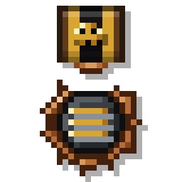 | 24 | **Знак ветерана** | Ветерану VOID. Полосы — прожитые в боях сезоны, череп на ленте — память о том, сколько раз смерть проходила мимо. | 240 | `medal_24.png` |

Медали сделаны генератором `medal_maker.py` (версия 3, копия — в базе Obsidian, «VOID_System — генератор медалей v3.py»).
